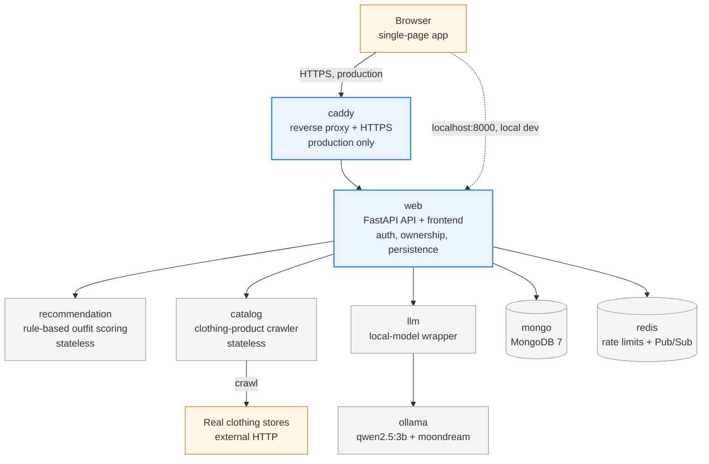

# Smart Wardrobe

**A digital wardrobe platform that manages your real clothes, generates
personalized outfits, learns your preferences over time, and includes a
local AI stylist — with grounded shopping suggestions and a small social
feed.**

Smart Wardrobe turns a user's actual clothing into a searchable digital
wardrobe and builds outfit recommendations on top of it. It remembers what
each user likes (from ratings, likes/dislikes, and plain conversation),
chats through a **locally hosted LLM** with no external AI API, can
pre-fill new wardrobe items from a photo using a local vision model, and
suggests **real, crawled store products** for gaps in a wardrobe — without
ever letting the AI invent a product.

It is a full-stack system: a browser single-page app in front of a
Docker Compose microservice backend (FastAPI, MongoDB, Redis, Ollama, and
a Caddy reverse proxy in production), backed by more than 1,500 automated
tests.

---

## Contents

- [Why it exists](#why-it-exists)
- [Demo](#demo)
- [Key features](#key-features)
- [Architecture](#architecture)
- [Tech stack](#tech-stack)
- [Quick start](#quick-start)
- [Local AI models](#local-ai-models)
- [Demo data](#demo-data)
- [Testing](#testing)
- [Security](#security)
- [Production architecture](#production-architecture)
- [Engineering decisions](#engineering-decisions)
- [Project structure](#project-structure)
- [Documentation](#documentation)
- [Team](#team)
- [Project status](#project-status)

---

## Why it exists

Most people own more clothes than they actually wear: items get forgotten,
outfits get repeated, and "what should I wear?" stays a daily guess. Smart
Wardrobe makes a user's real closet visible and searchable, recommends
complete outfits from what they actually own, and gets better the more it
is used — without asking the user to re-describe their taste every session.

## Demo

There is no publicly hosted instance at the moment. The full stack runs
locally with one command (see [Quick start](#quick-start)), and a fresh
local install is automatically populated with demo users and forum content
so there is something to explore immediately.

Once running, the app is at `http://localhost:8000/ui/` and the interactive
API docs are at `http://localhost:8000/docs`.

<!-- Screenshots: add images under docs/images/ and reference them here. -->

## Key features

- **Wardrobe management** — add, edit, delete, and filter clothing items by
  type, color, season, style, and occasion.
- **AI photo analysis** — upload a photo of a single garment and a local
  vision model (`moondream`) pre-fills the item form for the user to review;
  the AI never saves anything by itself.
- **Personalized outfit recommendations** — rule-based scoring with a
  dress-vs-top+bottom model, re-verified against the database before being
  shown (stale or invalid items are replaced or reported missing, never
  invented).
- **Preference learning & long-term memory** — saved outfits, ratings,
  likes/dislikes, an explicit preference profile, and durable preferences
  extracted automatically from chat ("I hate black clothes") all feed one
  per-user profile stored in MongoDB.
- **Local AI stylist chat** — an asynchronous, queued chat backed by a local
  Ollama model (`qwen2.5:3b`), aware of the user's stored preferences.
- **Grounded catalog suggestions** — a dedicated crawler service fetches real
  products from four allowlisted Shopify stores (async, bounded concurrency,
  retry/backoff). Product facts shown in chat are rebuilt in code from the
  crawled data, never taken from model text.
- **Social feed** — posts (optionally anonymous), comments, reactions,
  image and MP4 attachments, and "Recreate with My Wardrobe", which matches
  a shared outfit against the viewer's own closet.
- **Direct messages & live notifications** — private one-to-one messaging
  with private media, and real-time notifications over WebSocket that work
  across multiple backend replicas.

See [`docs/features.md`](docs/features.md) for the full, per-feature
breakdown.

## Architecture



| Service | Role |
|---|---|
| `web` | FastAPI backend + served frontend. Owns auth, persistence, ownership scoping, recommendation/chat orchestration, forum, DMs, and WebSocket delivery. Stateless, so it scales horizontally. |
| `recommendation` | Stateless rule-based outfit scoring engine with no database access. |
| `llm` | Thin wrapper around the local Ollama runtime — the only path to a model. |
| `catalog` | Stateless clothing-product crawler: four real Shopify stores plus a deterministic mock source. |
| `mongo` | MongoDB 7 — all persistent application data. |
| `redis` | Shared rate-limit counters and cross-replica live-notification Pub/Sub. |
| `ollama` | Local model runtime (`qwen2.5:3b` text, `moondream:latest` vision). |
| `caddy` | Production-only reverse proxy: HTTPS termination and load balancing across `web` replicas. |

Only one service is ever reachable from outside the Docker network: `web`
in local development (`localhost:8000`), or `caddy` in production (80/443).
Everything else is internal-only. See
[`docs/architecture.md`](docs/architecture.md) for data-flow walkthroughs
and design rationale.

## Tech stack

| Area | Technology |
|---|---|
| Backend | Python 3.11, FastAPI, Uvicorn, Pydantic |
| Database | MongoDB 7 (Motor async driver) |
| Cache / messaging | Redis 7 — shared rate limiting, Pub/Sub for live events |
| AI | Ollama (local) — `qwen2.5:3b` for chat, `moondream:latest` for vision |
| Crawling | `httpx` async client, bounded concurrency, retry with exponential backoff |
| Frontend | Vanilla JavaScript single-page app served by the backend (no build step) |
| Infrastructure | Docker, Docker Compose, Caddy (automatic HTTPS, load balancing) |
| Testing | pytest, `mongomock-motor`, `fakeredis`, real-Mongo and real-HTTP system tests |
| CI | GitHub Actions — unit tests, Docker image builds, live MongoDB integration smoke test |

## Quick start

**Prerequisites:** Docker with the `docker compose` plugin. Nothing else is
required on the host — no Python, Node, or database install. Allow a few GB
of disk for images plus ~3.6 GB for the two local AI models.

```bash
git clone https://github.com/doniahas/smart-wardrobe-platform.git smart-wardrobe
cd smart-wardrobe
cp .env.example .env
```

Edit `.env` and set the three required secrets:

```text
JWT_SECRET=<a long random value>
MONGO_ROOT_USERNAME=admin
MONGO_ROOT_PASSWORD=<a password you choose - letters and numbers only>
```

You can generate a secret using only Docker:

```bash
docker run --rm python:3.11-slim python -c "import secrets; print(secrets.token_hex(32))"
```

The app refuses to start without a real `JWT_SECRET`. Keep the Mongo
credentials to letters and numbers, since they are interpolated into a
connection URI. `.env` is gitignored — never commit real secrets.

Start the stack:

```bash
docker compose up -d
```

Open `http://localhost:8000/ui/` (the bare `/` redirects there).

> **Linux Docker permissions:** if `docker info` fails with "permission
> denied … docker.sock", add your user to the `docker` group
> (`sudo usermod -aG docker "$USER"`) and start a new shell session.

Every command in this README works the same in a Linux/macOS shell, Git
Bash, or Windows PowerShell.

## Local AI models

All AI inference runs on your machine through the bundled Ollama container —
no API keys, no per-token cost, and conversations never leave the
deployment. Pull the two models once per machine (they persist in a Docker
volume):

```bash
docker compose exec ollama ollama pull qwen2.5:3b
docker compose exec ollama ollama pull moondream:latest
```

The rest of the app works without them; chat and photo analysis return a
controlled error until the models are present. On CPU-only hardware,
expect replies and photo analysis to take tens of seconds.

## Demo data

A fresh local `docker compose up -d` seeds the forum automatically: a
one-shot `seed` service runs `scripts/seed_demo_data.py` against the real
API, creating a few demo users, posts, comments, and reactions.

- Demo accounts: `demo_alex`, `demo_bianca`, `demo_chen`, `demo_dara`,
  `demo_elin`
- Password: `DemoSeed123!` — a deterministic, **local/demo-only** credential

Seeding is idempotent (each object is reconciled individually, never
duplicated) and controlled by `SEED_DEMO_DATA` in `.env`. **The production
overlay hard-disables it**, so a public deployment is never seeded with
these well-known credentials. To force a reconciliation pass on a running
local stack: `./scripts/start_demo.sh`.

## Testing

Each backend service has its own independent pytest suite. None of them
needs a running database, Redis, or the application stack — MongoDB is
faked with `mongomock-motor`, Redis with `fakeredis`, and outbound HTTP is
mocked.

| Suite | Tests |
|---|---|
| `web` — unit, integration, security, concurrency/stress | 1,306 |
| `catalog` — crawler, adapters, retry/backoff, timeouts | 177 |
| `recommendation` — scoring engine | 30 |
| `llm` — model wrapper | 20 |

Run every suite in disposable `python:3.11-slim` containers (Docker is the
only requirement):

```bash
./scripts/run_tests_docker.sh                # Linux / macOS / Git Bash
./scripts/run_tests_docker.sh web catalog    # or just specific services
```

```powershell
.\scripts\run_tests_docker.ps1               # Windows PowerShell
```

Beyond the per-service suites:

- **Live MongoDB tests** (`tests/system/test_live_mongo_*.py`) — real
  unique-index enforcement, duplicate-key handling, delete cascades, and
  atomic job claiming against a real `mongo:7` server (run in CI).
- **System / end-to-end tests** (`tests/system/test_e2e_*.py`, opt-in via
  `RUN_E2E_TESTS=1`) — real HTTP and WebSocket clients against running
  containers: the wardrobe flow, catalog grounding (success and outage),
  and the forum flow including live notification delivery over Redis.
- **Chat load test** (`scripts/chat_load_test.py`) — concurrent users
  driving the real chat queue against a live stack and model.

See [`docs/testing.md`](docs/testing.md) for coverage details, the E2E
recipes, and known limitations.

## Security

- Passwords hashed with bcrypt; JWT (HS256) sessions with expiry; the app
  refuses to start with a missing or placeholder secret.
- Every resource is scoped server-side to the authenticated user. "Not
  found" and "not yours" both return `404`, so resource existence can't be
  probed.
- Per-route, configurable rate limits on every user-facing write path,
  shared across replicas through Redis.
- Uploads (images and MP4 video) are validated from real file content —
  never the filename or client-declared `Content-Type` — with size limits
  enforced during a bounded read. Wardrobe images are served via signed,
  expiring URLs; DM media only through an authenticated, participant-scoped
  endpoint.
- Prompt-injection hardening: user memory and third-party product text are
  treated as data and sanitized before reaching the model.
- A dedicated adversarial test suite covers cross-user authorization, path
  traversal, malformed JSON, injection-style input, MIME spoofing, MP4
  container validation, oversized uploads, and private DM media isolation.

Details and residual risks:
[`docs/security-testing-report.md`](docs/security-testing-report.md).

## Production architecture

`docker-compose.prod.yml` is an overlay on the base Compose file for a
self-hosted Linux server (VPS or VM) with a DNS name:

- **Caddy** is the only public entry point — automatic HTTPS for the
  configured `DOMAIN`, and round-robin load balancing across `web` replicas
  using Docker DNS-based dynamic upstreams.
- **Two stateless `web` replicas** by default (`scale: 2`), with no host
  port of their own; JWTs, rate limits, and live notifications all work
  across replicas because shared state lives in MongoDB and Redis.
- Restart policies on every long-running service, demo seeding
  hard-disabled, and internal services never published.
- Backup, verification, and restore scripts for MongoDB and uploaded media
  live in `scripts/`.

```bash
docker compose -f docker-compose.yml -f docker-compose.prod.yml up -d --build
```

Deployment is operator-managed: CI validates tests and image builds but does
not deploy. See [`docs/deployment.md`](docs/deployment.md) for setup,
scaling, backups, and recovery.

## Engineering decisions

- **Local LLM instead of an external AI API** — no keys, no per-token cost,
  and user conversations stay inside the deployment, at the cost of a
  one-time model download and slower CPU inference.
- **The AI is never trusted for facts** — recommended items are re-verified
  against MongoDB, and when chat mentions real products, the reply is
  rebuilt in code from crawled catalog data; with nothing verified, the
  user gets an honest "nothing verified" answer instead of an invented one.
- **Long-term memory lives in the database, not the prompt window** —
  durable preferences are extracted under a strict schema, stored per
  user, and committed before the reply is shown, so they survive restarts
  and new sessions.
- **Stateless `web`, shared state in MongoDB/Redis** — enables horizontal
  scaling with one combined rate limit and cross-replica WebSocket delivery.
- **Graceful degradation** — if the catalog, LLM, or Redis is unavailable,
  the affected feature degrades with a clear response while the rest of the
  app keeps working; a MongoDB outage returns a clean `503`, not a crash.
- **A queue for chat** — chat requests are persisted jobs processed by a
  bounded worker pool with claim fencing and stale-job recovery, so slow
  model calls can't overwhelm the server or be lost on a crash.

## Project structure

```text
smart-wardrobe/
├── docker-compose.yml        # local stack (single web instance on :8000)
├── docker-compose.prod.yml   # production overlay (Caddy, 2 web replicas, restart policies)
├── Caddyfile                 # HTTPS + load-balancing config
├── .env.example              # every configuration option, secrets left blank
├── .github/workflows/ci.yml  # unit tests, Docker builds, live MongoDB smoke test
├── services/
│   ├── web/                  # FastAPI API + frontend (static/), tests/ incl. security/ and integration/
│   ├── recommendation/       # stateless rule-based outfit scoring
│   ├── llm/                  # local-model wrapper around Ollama
│   └── catalog/              # stateless clothing-product crawler
├── tests/system/             # live-MongoDB and opt-in end-to-end tests
├── scripts/                  # test runners, demo seeding, chat load test, backup/restore
└── docs/                     # architecture, features, data model, testing, security, deployment
```

## Documentation

- [`docs/architecture.md`](docs/architecture.md) — services, data flows, and design decisions
- [`docs/features.md`](docs/features.md) — every feature, by subsystem, with its API surface
- [`docs/data-model.md`](docs/data-model.md) — MongoDB collections and indexes
- [`docs/testing.md`](docs/testing.md) — test strategy, how to run every tier, known limitations
- [`docs/security-testing-report.md`](docs/security-testing-report.md) — adversarial security testing and residual risks
- [`docs/deployment.md`](docs/deployment.md) — production deployment, scaling, backups, and recovery

## Team

Smart Wardrobe was designed and built collaboratively by:

- **Donia Hassan**
- **Lana Asmar**
- **Jana Glyanos**

## Project status

Feature-complete and fully functional locally, with the automated test
suites passing. No public instance is currently hosted. Known limitations:

- **Single MongoDB node.** The application tier scales horizontally, but the
  production overlay runs one MongoDB instance without a replica set.
- **Small local model.** `qwen2.5:3b` keeps hardware requirements modest; a
  larger model would give richer styling advice. Product-fact accuracy does
  not depend on model size, since product facts are rebuilt from catalog
  data.
- **Catalog coverage.** Four allowlisted stores; each new retailer needs a
  reviewed adapter configuration.
- **No automated browser tests.** Frontend behavior is verified manually;
  the automated suites cover the API and served content.
- **Weather-aware recommendations** are not implemented.
